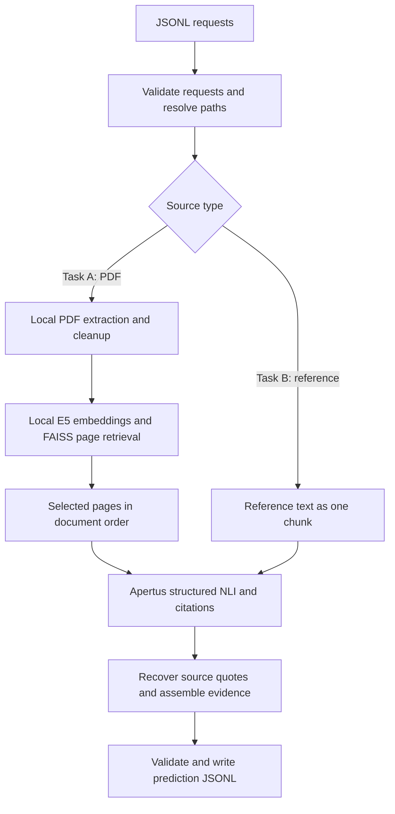

# Technical report: Apertus ClaimCheck

- **Track:** Track 2A, OST: Multilingual Natural Language Inference over Swiss Official Voting Booklets
- **Event:** Hack Apertus, Online
- **Team:** HSLU Team 1
- **Members:** Karim Darwiche and Laurin Lötscher
- **Date:** 16 October 2026
- **Repository:** [codewithlaurin/I.BA_AICOMP.H2601_Track_2A_OST](https://github.com/codewithlaurin/I.BA_AICOMP.H2601_Track_2A_OST)
- **Implementation reviewed:** `8c023751882f681821fdbb8965e7a053f6dc549a`
- **Demo:** Link forthcoming; a local browser demo is available in `scripts/demo_gui.py`.

## 1. Summary

Apertus ClaimCheck classifies claims against official Swiss voting materials in German, French, and Italian, including all nine source-language/claim-language combinations. Task A receives a booklet PDF and retrieves relevant pages; Task B receives a reference passage directly. Both paths use a shared Apertus prompt and return an entailment, neutral, or contradiction label, source evidence, and token/time metrics.

The approach combines local CPU-based PDF extraction and multilingual page retrieval with one logical Apertus classification call per case. Recorded development experiments with Apertus v1.5 8B achieved **0.939 macro-F1 on Task B** and **0.878 macro-F1 with 0.842 evidence Hit@5 on Task A**, each on a public-data snapshot reported as 1,495 cases. A 30-case comparison reduced average input tokens from approximately 31,600 for full-document inference to 4,883 with retrieval, an approximately 85% reduction.

These are historical results from [docs/RESULTS.md](docs/RESULTS.md), not a new evaluation of the submission defaults. The reviewed code defaults to **Apertus v1.5 70B and five retrieved pages**; the primary recorded experiments used **8B and eight pages**. No full benchmark result is attributed here to the current defaults. The organisers' private held-out evaluation has not been observed.

## 2. Architecture

### 2.1 Input and output

The Python CLI reads JSONL through `--input` and writes JSONL through `--output`. Requests contain an ID, vote title, claim, and exactly one source: a booklet path for Task A or reference text for Task B. All requests are validated before the output is opened. Duplicate IDs are rejected, and relative PDF paths resolve against the input file's directory. Cases are processed sequentially.

| Label | Name | Meaning relative to the supplied source |
| --- | --- | --- |
| 0 | entailment | The source supports the claim. |
| 1 | neutral | The source provides insufficient information. |
| 2 | contradiction | The source contradicts the claim. |

Predictions preserve the input ID and include `evidence` plus `metrics.input_tokens`, `metrics.output_tokens`, and `metrics.inference_time_ms`. Validation checks the label/name pairing, evidence limits, page format, and nonnegative metrics before each prediction is written.



### 2.2 Booklet extraction

[predict.py](src/claimcheck/predict.py) extracts text with `pypdfium2`, using character positions to reconstruct reading order and place short margin labels before their paragraphs. It joins soft-hyphen line breaks and removes extraction control characters. Pages with fewer than 50 remaining characters after removing a leading page number are treated as filler. Evidence retains physical, 1-based PDF page numbers.

Pages containing Form XObjects receive a second extraction with `pypdf`. That text replaces the primary version only when it is more than 100 characters longer and more than 15% of its character shingles are new. This targets embedded text missed by the primary extractor while avoiding the second extraction on every page. The pipeline has no OCR stage.

### 2.3 Multilingual retrieval

[retrieval.py](src/claimcheck/retrieval.py) uses `intfloat/multilingual-e5-small` through Sentence Transformers on CPU. Each retained page is embedded as `passage: ` followed by its first 2,500 characters. The query is `query: ` followed by the claim and vote title. Selected pages are subsequently supplied to Apertus with their full extracted text, rather than only the embedding prefix.

Normalized embeddings are stored in a per-booklet FAISS `IndexFlatIP` index. Inner-product ranking therefore corresponds to cosine ranking. The current default is five pages. Evidence assembly retains retrieval relevance order, while the model receives pages in document order. `CLAIMCHECK_FULL_DOCUMENT=1` bypasses retrieval and supplies all retained pages as the baseline.

Extracted pages, indexes, and query embeddings are cached in memory; up to 256 booklet indexes are retained. Caches reuse source processing and do not read gold labels or previous predictions. Embedding batches default to four, and PyTorch uses at most four threads unless explicit operator settings apply.

### 2.4 Evidence and failures

Apertus proposes short quotes with chunk identifiers. RapidFuzz partial alignment searches the indicated chunk, then other supplied chunks if needed, with a threshold of 90. The output contains the recovered source span in its original language, rather than the model's potentially altered quotation.

For a non-neutral label without a recoverable quote, the application cites the best-matching chunk, capped at 5,000 characters. In retrieval mode, retrieved page excerpts are then appended in relevance order until at most five evidence items are present. Task A items have physical PDF page numbers; Task B items use `page: null`. Neutral predictions have no evidence.

Missing or blank API credentials cause an error and exit code 1 before predictions are written. Incompatible model names are rejected at startup. Per-case extraction or API exceptions are logged to stderr and fall back to neutral so processing can continue. Unparseable model output also becomes neutral. Such operational fallbacks must be distinguished from an evidence-based neutral assessment when inspecting logs.

## 3. Use of Apertus

Apertus performs NLI and proposes citations through an OpenAI-compatible hosted API. There is no fine-tuning, adapter, or local Apertus serving stack. All remote model calls use runtime `BASE_URL`, allowing the organisers to inject their token-counting proxy. The only supporting model in the prediction pipeline is the local E5 embedder; parsing, retrieval, and quote matching run locally.

The prompt, `judge-nli-v4`, is included in [nli.py](src/claimcheck/nli.py). It asks the model to translate the claim literally into English, identify whether its topic is addressed, state what the passage says, compare meanings, and return a structured JSON label with source-language citations. Actors, values, dates, negations, and positions should be preserved. The model is instructed to use only supplied passages, treat claims and passages as data, and avoid political recommendations.

Postprocessing derives the label from the structured fields: an unaddressed topic gives neutral, matching meaning gives entailment, and differing meaning gives contradiction. If the comparison fields are unavailable, the model's label is used. This practical heuristic can confuse incomplete support with contradiction, as discussed in Section 6.

Requests use temperature 0, a maximum of 1,024 completion tokens, a 90-second client timeout, and at most one SDK retry. One logical classification call can therefore involve an additional remote attempt. The current default is `swiss-ai/Apertus-v1.5-70B`; `LLM_NAME` can select another `swiss-ai/Apertus-v1.5-...` model. The primary historical results below use `swiss-ai/Apertus-v1.5-8B`.

## 4. Data

Development uses [OSTswiss/MNLIoverSwissVotingBooklets](https://huggingface.co/datasets/OSTswiss/MNLIoverSwissVotingBooklets): claims, human-annotated NLI labels, reference passages, vote titles, and booklet URLs in German, French, and Italian. PDFs originate from the [Swiss Federal Chancellery's voting-booklet archive](https://www.bk.admin.ch/de/sammlung-der-abstimmungsbuechlein-seit-1978).

For Task A, the gold reference is withheld from inference and used only for evidence scoring. For Task B, that reference passage is the intended source input. Gold labels are used only for development and scoring, never by the predictor. No new human-subject data was collected for this implementation.

Dataset versions matter: the historical results notes record 1,495 rows and 60 booklets, whereas a later local `v1.1` snapshot contains 1,488 rows. This report preserves each experiment's recorded sample size. Row-based IDs may change across revisions; reproducing a run requires its matching cases and gold-label snapshot.

The committed `data/` contains a two-case example and one PDF, approximately 3.1 MiB in total. Full evaluation data, duplicate downloads, parsed caches, and run outputs are ignored by Git. Upstream datasets, official documents, and model weights retain their own licensing terms. The dataset's license is not recorded in this repository and was not independently verified for this report.

## 5. Evaluation

### 5.1 Method and provenance

[scripts/official_evaluate.py](scripts/official_evaluate.py) is identified in its header as a copy of the organisers' evaluator dated 9 October 2026. It measures three-way macro-F1 and Task A evidence Hit@5. An evidence hit requires one of the first five excerpts to overlap the gold passage under normalized fuzzy matching, over gold entailment/contradiction cases. The prediction contract separately enforces 1-based pages and a 5,000-character item limit.

All benchmark numbers below come from the tracked [results notes](docs/RESULTS.md); they were not rerun for this report. Later ignored experiment outputs contain other retrieval and prompt variants without a complete mapping to the reviewed code. They are not presented as final-configuration scores.

### 5.2 Task B: reference-only inference

| 8B configuration | Cases | Macro-F1 | Entailment F1 | Neutral F1 | Contradiction F1 |
| --- | ---: | ---: | ---: | ---: | ---: |
| Prompt v4, quote failure forces neutral, 10 Oct | 1,495 | 0.887 | 0.913 | 0.887 | 0.860 |
| Prompt v4, quote rule removed, 10 Oct | 1,495 | 0.938 | 0.949 | 0.958 | 0.908 |
| Prompt v4, repeat run, 12 Oct | 1,495 | **0.939** | 0.950 | 0.959 | 0.908 |

The repeat run recorded accuracy 0.939, averages of 3,182 input and 136 output tokens, and approximately 1.0 second per case. Earlier runs required rerunning IDs affected by network outages and merging predictions; the repeat run completed in one pass.

Forcing neutral when quote recovery failed hurt classification: the notes identify 80 affected cases, all with gold entailment or contradiction labels. The implementation therefore repairs evidence without changing a label solely because quote recovery failed. A prompt-v5 alternative scored 0.926 macro-F1 and was reverted.

One hundred public rows were used for prompt tuning. The full-public-set score is consequently a development result. A disjoint 100-row holdout recorded macro-F1 0.92; it remains a public-data holdout, not the organisers' private test set.

### 5.3 Task A: booklet inference

The recorded 12 October run used 8B, prompt v4, and eight retrieved pages over 60 booklets.

| Cases | Macro-F1 | Accuracy | Entailment F1 | Neutral F1 | Contradiction F1 | Evidence Hit@5 |
| ---: | ---: | ---: | ---: | ---: | ---: | ---: |
| 1,495 | **0.878** | 0.878 | 0.835 | 0.960 | 0.841 | **0.842** |

It recorded zero invalid lines, averages of 4,691 input and 151 output tokens, and approximately 1.5 seconds per case. PDF extraction and index construction were amortized over cases sharing each booklet. Task A macro-F1 was approximately 0.06 below Task B on the same recorded rows, consistent with additional retrieval and context-selection difficulty, without isolating their causal contribution.

Recorded Task A macro-F1 by source/claim language:

| Source language | German claim | French claim | Italian claim |
| --- | ---: | ---: | ---: |
| German | 0.94 | 0.89 | 0.83 |
| French | 0.82 | 0.90 | 0.88 |
| Italian | 0.83 | 0.89 | 0.90 |

These subgroup values are rounded; no confidence intervals were recorded.

### 5.4 Full-document baseline versus retrieval

The 30-case Task A comparison used the same 8B model and prompt for both strategies.

| Context strategy | Macro-F1 | Evidence Hit@5 | Mean input tokens | Mean time/case |
| --- | ---: | ---: | ---: | ---: |
| Full retained document | 0.79 | 0.32 | approximately 31,600 | approximately 8 s |
| Eight retrieved pages | 0.95 | 0.88 | 4,883 | 1.2 s |

Retrieval reduced input tokens by approximately **84.5%** and improved classification and evidence matching on this small sample. Twenty-two of 25 gold entailment/contradiction cases had matching evidence. Its macro-F1 of 0.95 exceeded the later full-public-set result of 0.878, showing that the small sample overestimated broader performance.

A separate recorded retrieval study on 429 public rows found the gold page within the top eight in 91% of cases with E5, compared with 76% for BM25. This measures page retrieval, not end-to-end classification or evidence accuracy.

### 5.5 Efficiency and verification status

The organisers measure remote tokens through their proxy and processing time excluding periods with an LLM request in flight. The CLI's `inference_time_ms` instead reports full case wall-clock time, including API latency, extraction, and retrieval. Historical local measurements cannot establish the official relative efficiency score.

The README records approximately 1.1 GB peak memory for 50 Task A cases with 29 cached booklets and an image of approximately 3 GB. Earlier results notes record approximately 19 seconds for embedding-model loading and six seconds for index construction per booklet. Host hardware and complete measurement protocols were not preserved; these are indicative measurements, not resource guarantees.

An offline test run against reviewed commit `8c02375` on 16 October 2026 ran 30 tests: **25 passed, three failed, and two were skipped**. One CLI test still expects the removed no-key neutral stub. Two timing tests expect API latency to be excluded from a wall-clock metric. The skipped tests require booklet files at paths absent from this checkout. No new remote benchmark was performed for this report. During final submission preparation, the image was rebuilt for `linux/amd64`; CPU-only dependencies, offline embedding-model loading, and the missing-key configuration error were checked successfully.

## 6. Limitations

- **Current defaults:** the recorded primary results use 8B/eight pages. Their scores do not validate the current 70B/five-page configuration.
- **Benchmark reuse:** public examples informed prompt selection. Public-set scores and small holdouts do not establish private-set performance.
- **Retrieval omissions:** only page prefixes are embedded, and model tokenization may truncate them further. Relevant passages beyond those prefixes or outside the selected pages may be missed, especially for distributed evidence.
- **Extraction:** geometric rules are tailored to booklets. Scans, unusual layouts, and complex tables may fail; there is no OCR. The filler heuristic can remove short but meaningful pages.
- **Inference:** the structured comparison can treat partially supported claims as contradictions. Actor attribution, negation, quantities, and cross-language meaning remain sources of error.
- **Evidence:** whole-page fallbacks include unrelated text. A quote and an excerpt from the same page can occupy multiple slots. Relevant text beyond 5,000 characters is omitted from page excerpts. Fuzzy overlap is a proxy for complete justification.
- **Failure accounting:** operational failures become neutral and are distinguished only in stderr. Their fallback token counts are zero even if a failed remote attempt incurred usage; the proxy is authoritative for official accounting.
- **Reproducibility:** hosted inference may vary despite temperature 0. The base-image tag and embedding-model download are not pinned by immutable digest/revision. Historical input hashes, hardware specifications, and some run artifacts are not tracked.

The application assesses consistency with a supplied source. Its predictions should be shown with evidence and should not be presented as authoritative political advice or verification against all real-world information.

## 7. Reproducibility and deployment

### 7.1 Environment

The execution root is `track_2a/`. The Dockerfile uses Python 3.12, targets `linux/amd64`, and requires no GPU. Dependencies are constrained by `uv.lock`. The build installs CPU-only PyTorch, checks for CUDA-package absence, downloads E5 into `/opt/models/multilingual-e5-small`, and verifies offline loading. Runtime Hugging Face and Transformers offline flags prevent model downloads.

The Docker build allowlist includes package source, project metadata, the lockfile, and Dockerfile. It excludes `.env`, gold labels, data, and experiment outputs. Cases and booklets are mounted read-only under `/data`, predictions go to `/output`, and writable cache locations are under `/tmp`. A local `.env` can be passed by the Makefile at runtime; explicit environment values take precedence.

| Setting | Current default or behavior |
| --- | --- |
| `BASE_URL` | `https://api.inference.cscs.ch/v1`; evaluation can inject the proxy |
| `API_KEY` | Required; missing or blank values fail before output |
| `LLM_NAME` | `swiss-ai/Apertus-v1.5-70B` |
| `CLAIMCHECK_TOP_K` | `5` |
| `CLAIMCHECK_FULL_DOCUMENT` | Unset; `1` bypasses retrieval |
| `EMBEDDING_MODEL` | `/opt/models/multilingual-e5-small` in Docker |
| `CLAIMCHECK_EMBEDDING_BATCH_SIZE` | `4` |
| `CLAIMCHECK_CPU_THREADS` | At most four by default, unless explicit thread settings apply |

Legacy aliases are `LLM_BASE_URL`, `LLM_API_KEY`, `CSCS_INFERENCE_API_KEY`, and `APERTUS_MODEL`. Canonical variables take precedence.

### 7.2 Run and score

From the repository root, with `API_KEY` already set in the shell:

```bash
cd track_2a
export BASE_URL=https://api.inference.cscs.ch/v1
export LLM_NAME=swiss-ai/Apertus-v1.5-70B
make run
```

For another input, use `make run INPUT=/path/to/cases.jsonl OUTPUT=/path/to/predictions.jsonl`. Booklet paths should resolve inside `booklets/` next to the cases file. Keep gold-label files outside prediction-container mounts.

The explicit Docker command supports retrieval configuration:

```bash
docker build --platform linux/amd64 -t apertus-claimcheck:latest .
mkdir -p output
docker run --rm --platform linux/amd64 \
  -e BASE_URL -e API_KEY -e LLM_NAME -e CLAIMCHECK_TOP_K=5 \
  -v "$PWD/data/cases.jsonl:/data/cases.jsonl:ro" \
  -v "$PWD/data/booklets:/data/booklets:ro" \
  -v "$PWD/output:/output" \
  apertus-claimcheck:latest \
  --input /data/cases.jsonl --output /output/predictions.jsonl
```

For the historical choices, set `LLM_NAME=swiss-ai/Apertus-v1.5-8B` and pass `-e CLAIMCHECK_TOP_K=8`. Add `-e CLAIMCHECK_FULL_DOCUMENT=1` for the baseline. These changes recreate configuration choices, not the historical code or dataset snapshot. The Makefile does not automatically forward retrieval-tuning variables, so pass them explicitly with Docker.

Score on the host with cases and labels from the same snapshot:

```bash
uv run --with scikit-learn python scripts/official_evaluate.py \
  --predictions output/predictions.jsonl \
  --expected /path/to/expected-labels.jsonl \
  --cases /path/to/cases.jsonl

make test
```

For the local demo, run `uv run --env-file .env python scripts/demo_gui.py --pdf-dir data/booklets` and open the displayed localhost address. `scripts/extraction_viewer.py` creates a side-by-side PDF/text view for inspecting extraction.

Exact reproduction requires retaining the code commit, model name, dataset revision, case IDs, input/gold hashes, retrieval settings, image digest, and hardware information together with predictions and scorer output.

The final `linux/amd64` container was built from the source at repository commit `a949a594dfc7ce0bc9dc49edfe831af765423885` and published publicly to [GitHub Container Registry](https://github.com/users/codewithlaurin/packages/container/package/i.ba_aicomp.h2601_track_2a_ost). Its tag is `ghcr.io/codewithlaurin/i.ba_aicomp.h2601_track_2a_ost:latest`, and its immutable reference is:

```text
ghcr.io/codewithlaurin/i.ba_aicomp.h2601_track_2a_ost@sha256:f2faee4de008296d6ecdc50b5393b1d75a24baa0225cd9211085b449a4c1045c
```

Use this image in place of `apertus-claimcheck:latest` in the Docker command above to run without rebuilding.

## 8. Next steps

The immediate priority is a controlled comparison of 8B and 70B with five and eight retrieved pages on the same frozen cases. Measure quality, tokens, cold-start costs, and local processing time separately, refresh the results, and resolve the three test expectation failures before submission.

Further improvements include token-aware paragraph chunks with page provenance, evidence windows without redundant page coverage, booklet-level holdouts, and separate retrieval/inference error analysis. More precise handling of incomplete support should reduce neutral/contradiction confusion. Complete failed-attempt usage accounting and immutable model/image references would strengthen reproducibility.

## License

The software uses [Apache License 2.0](../LICENSE). This report follows the template's Creative Commons Attribution 4.0 (CC BY 4.0) designation. The [E5 model card](https://huggingface.co/intfloat/multilingual-e5-small) identifies its license as MIT. Third-party datasets, PDFs, models, and dependencies retain their respective licenses.

## References

- [Recorded development results](docs/RESULTS.md): historical benchmark and timing evidence.
- [CLI](src/claimcheck/cli.py), [PDF processing](src/claimcheck/predict.py), [retrieval](src/claimcheck/retrieval.py), and [NLI prompt/postprocessing](src/claimcheck/nli.py): implementation sources.
- [Dockerfile](Dockerfile), [Makefile](Makefile), and [uv.lock](uv.lock): deployment and dependency configuration.
- [Local official evaluator](scripts/official_evaluate.py): classification and evidence scoring.
- [OSTswiss/MNLIoverSwissVotingBooklets](https://huggingface.co/datasets/OSTswiss/MNLIoverSwissVotingBooklets): public development dataset.
- [Federal Chancellery archive](https://www.bk.admin.ch/de/sammlung-der-abstimmungsbuechlein-seit-1978): source booklets.
- [multilingual-e5-small](https://huggingface.co/intfloat/multilingual-e5-small): local retrieval model.
- OST, *HackApertus Track 2A: Q&A*, 8 October 2026, and the supplied *Solution API Guide*: task and evaluation contract.
